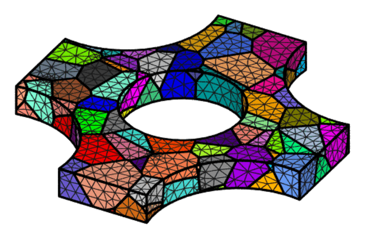
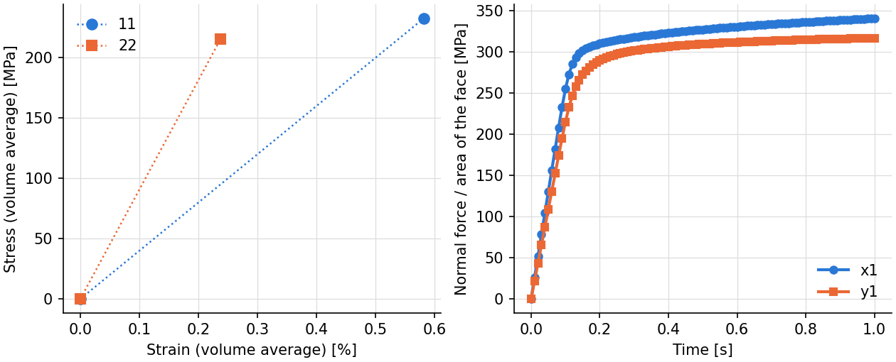
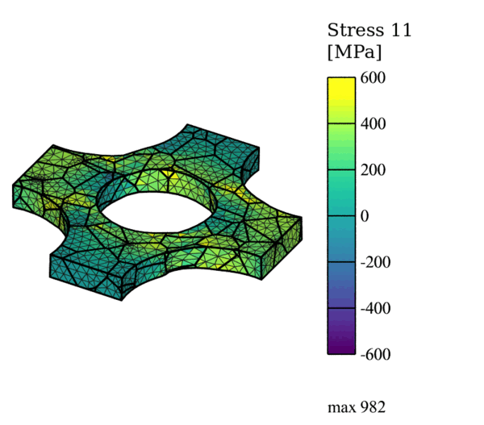
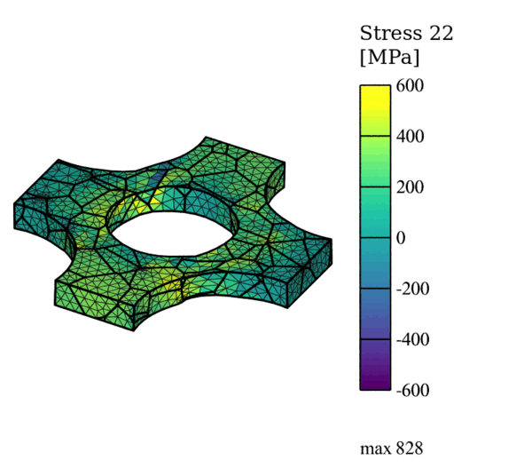
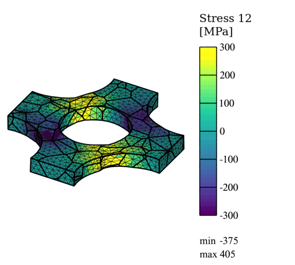

.. _tutorial_cruciform:

Cruciform Specimen
==================

.. note:: Read first: :ref:`tutorial_simple`.

The domain is a polycrystalline specimen of 88 grains for biaxial loading, generated and meshed
by Neper: a square plate whose corners are cut out by circular arcs, which leaves four arms, with
a central hole:

   The mesh (12737 10-node tetrahedra), colored by grain.

The specimen's (maximal) dimensions are 1, 1 and 0.1 mm along :math:`x`, :math:`y` and
:math:`z`. The material is that of :ref:`tutorial_simple`:

.. include:: material_simple.inc

The specimen is loaded biaxially by opposite velocities on its opposite arms: 0.01 mm/s along
:math:`x` on faces :file:`x0` and :file:`x1`, and half of it, 0.005 mm/s, along :math:`y` on
faces :file:`y0` and :file:`y1` (a strain biaxiality ratio of 0.5); the motion along
:math:`z` of the nodes of the edge :file:`x0z0cut1` is blocked against rigid-body motion. The
loading lasts 1 s, in increments of 0.01 s. The ratio is set by the velocities along :math:`y`
(lines 24 and 25): equal velocities give equal-biaxial loading, zero velocities uniaxial
loading in :math:`x` with the :math:`y` arms held in place. To let the :math:`y` arms move
freely while their faces stay plane, replace the two :math:`y` lines with multi-point
constraints (:ref:`multi_point_constraints`):

.. Not run: a variant of this input for the reader to try (the test suite runs no cruciform).

.. code-block:: none

  set_mpc1 vel y0 y
  set_mpc1 vel y1 y

This simulation takes about 1.5 h on 4 processes; it is not run by the test suite.

Input Files
-----------

- :download:`simulation.cfg <../../tutorials/cruciform/simulation.cfg>`
- :download:`simulation.msh <../../tests/regression/cases/meshes/tutorial_cruciform.msh>`

.. literalinclude:: ../../tutorials/cruciform/simulation.cfg
   :emphasize-lines: 21-26

Execution
---------

.. code-block:: console

  $ mpirun -np 4 fepx

.. literalinclude:: generated/cruciform/terminal.txt
   :language: none

.. literalinclude:: generated/cruciform/tree.txt
   :language: none

Simulation Results
------------------

   (left) Volume-averaged stresses 11 and 22 against the strains 11 and 22 (initial and final
   states); (right) normal stresses of faces :file:`x1` and :file:`y1` (force over current
   area) at every increment.

   Stress field :math:`\sigma_{11}` (displacements magnified 3 times).

   Stress field :math:`\sigma_{22}` (displacements magnified 3 times).

   Stress field :math:`\sigma_{12}` (displacements magnified 3 times).

The commands:

.. literalinclude:: generated/cruciform/commands.txt
   :language: console
