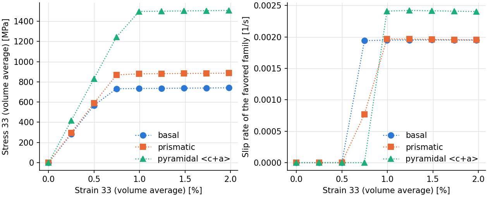

.. _tutorial_hcp_single_crystal:

An hcp Single Crystal: Slip Activity by Orientation
===================================================

.. note:: Read first: :ref:`tutorial_simple_rve`.

An hcp crystal deforms by slip on families of very different strengths. This tutorial pulls a
single crystal of the :math:`\alpha` phase of Ti-6Al-4V along :math:`z` in three orientations,
each of which puts one family in the most favorable position, and shows which family slips from
the slip-rate output. The material is that of :ref:`tutorial_multiaxial_csr`, with isotropic
hardening:

.. include:: material_ti.inc

.. list-table:: Plasticity parameters (``saturation_isotropic`` hardening; one value per family for :math:`m`, :math:`\dot{\gamma}_0` and :math:`\tau_0`: basal, prismatic, pyramidal :math:`\langle c+a \rangle`).
   :header-rows: 1
   :align: center

   * - :math:`m` [-]
     - :math:`\dot{\gamma}_0` [1/s]
     - :math:`\tau_0` [MPa]
     - :math:`h_0` [MPa]
     - :math:`\tau_s` [MPa]
     - :math:`n` [-]
   * - 0.01, 0.01, 0.01
     - 1.0, 1.0, 1.0
     - 390.0, 468.0, 663.0
     - 190.0
     - 700.0
     - 1.0

The mesh is the unit cube meshed as two cells (256 10-node tetrahedra), which are given the same
orientation, so that the material is one crystal. The orientations are read from
:file:`simulation.ori` (``read_ori_from_file``), one file per orientation, as Bunge Euler angles
:math:`(\varphi_1, \Phi, \varphi_2)` of the passive convention (sample to crystal frame, see
:ref:`file_formats`); the loading axis :math:`z` then has, in the crystal frame, the direction
:math:`(\sin\varphi_2 \sin\Phi, \cos\varphi_2 \sin\Phi, \cos\Phi)`:

.. list-table:: The three orientations (the crystal frame: :math:`x_c` along :math:`[2\bar{1}\bar{1}0]`, :math:`z_c` along :math:`c`, see :ref:`slip_systems`).
   :header-rows: 1
   :align: center

   * - File
     - :math:`(\varphi_1, \Phi, \varphi_2)` [°]
     - Loading axis in the crystal frame
     - Favored family (its Schmid factor)
   * - :download:`simulation_basal.ori <../../tutorials/hcp_single_crystal/simulation_basal.ori>`
     - (0, 45, 90)
     - 45° from :math:`c`, toward :math:`a_1`
     - basal (0.5)
   * - :download:`simulation_prismatic.ori <../../tutorials/hcp_single_crystal/simulation_prismatic.ori>`
     - (0, 90, 45)
     - in the basal plane, 45° from :math:`a_1`
     - prismatic (0.5)
   * - :download:`simulation_pyramidal.ori <../../tutorials/hcp_single_crystal/simulation_pyramidal.ori>`
     - (0, 0, 0)
     - along :math:`c`
     - pyramidal :math:`\langle c+a \rangle` (0.41; basal and prismatic: 0)

The crystal is pulled with the ``uniaxial_minimal`` conditions at 0.001 /s to 2 % strain, in 8
steps of 0.25 %, so that the slip rates are written every 0.25 %.

Input Files
-----------

- :download:`simulation.cfg <../../tutorials/hcp_single_crystal/simulation.cfg>`
- :download:`simulation.msh <../../tests/regression/cases/meshes/sx2.msh>`
- one of the three orientation files above, saved as :file:`simulation.ori`, e.g.:

.. literalinclude:: ../../tutorials/hcp_single_crystal/simulation_basal.ori
   :language: none

.. literalinclude:: ../../tutorials/hcp_single_crystal/simulation.cfg

Execution
---------

In three directories, one per orientation file; the mesh is not partitioned, and is small:
one process suffices.

.. code-block:: console

  $ mpirun -np 1 fepx

For the basal orientation:

.. literalinclude:: generated/hcp_basal/terminal.txt
   :language: none

.. literalinclude:: generated/hcp_basal/tree.txt
   :language: none

Simulation Results
------------------

   (left) Volume-averaged stress against strain of the three orientations: the crystal yields
   near :math:`\tau_0 / S \, (\dot{\varepsilon}/\dot{\gamma}_0)^m`, with :math:`\tau_0`
   and :math:`S` the strength and Schmid factor of the favored family (about 725, 870 and
   1520 MPa); (right) the slip rate of
   that family (the sum of the magnitudes of its systems' slip rates, averaged over the
   elements) against strain, at the ends of the steps. In each orientation the other two
   families do not slip.

The slip rates are those of :file:`results/elts/sliprate`, one column per system, in the order
of :ref:`slip_systems`: systems 1 to 3 are basal, 4 to 6 prismatic, 7 to 18 pyramidal
:math:`\langle c+a \rangle`. The commands, in the directory of the pyramidal orientation
(beside the other two):

.. literalinclude:: generated/hcp_pyramidal/commands.txt
   :language: console
