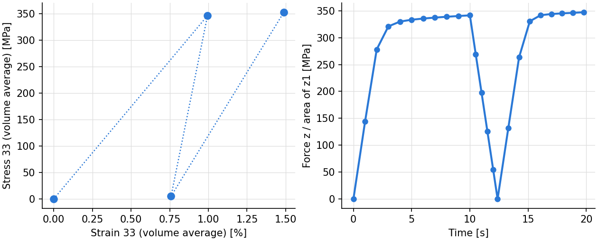
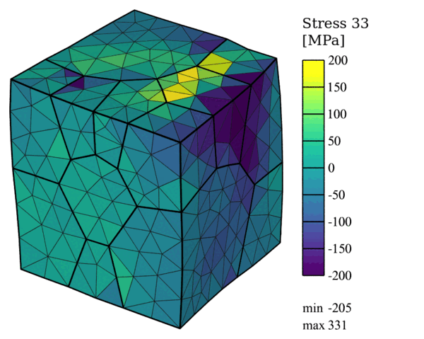

.. _tutorial_mixed_targets:

Loading, Unloading and Reloading: Mixed Targets
===============================================

.. note:: Read first: :ref:`tutorial_simple_rve`.

The polycrystal and material of :ref:`tutorial_simple` are loaded along :math:`z`, with the
``uniaxial_minimal`` conditions, in three steps that end at targets of different kinds (see
:ref:`deformation_history`):

1. loading at the strain rate 0.001 /s to the strain 0.01 (``target_strain``), in 10 equal
   increments;
2. unloading at the strain rate -0.001 /s to zero stress (``target_stress 33 0.0``), with
   increments of 0.5 s, shortened down to 0.01 s near the target: as the strain at which the
   stress vanishes is not known in advance, the step ends at the increment that reaches the
   stress target within its tolerance;
3. reloading at 0.001 /s to the strain 0.015, in 8 equal increments (``number_of_incrs``): its
   duration is known only when it starts, from the strain step 2 reached.

Each row gives one value per step, ``-`` where a keyword does not apply to that step.

Input Files
-----------

- :download:`simulation.cfg <../../tutorials/mixed_targets/simulation.cfg>`
- :download:`simulation.msh <../../tests/regression/cases/meshes/tutorial_simple_part4.msh>`

.. literalinclude:: ../../tutorials/mixed_targets/simulation.cfg
   :emphasize-lines: 25-30

Execution
---------

.. code-block:: console

  $ mpirun -np 4 fepx

.. literalinclude:: generated/mixed_targets/terminal.txt
   :language: none

.. literalinclude:: generated/mixed_targets/tree.txt
   :language: none

Simulation Results
------------------

   (left) Volume-averaged stress 33 against strain 33 at the ends of the steps: loaded, unloaded
   (a residual strain remains) and reloaded; (right) stress of face :file:`z1` (force over
   current area) at every increment: the increments shorten as the unloading approaches zero
   stress.

   Stress field :math:`\sigma_{33}` after unloading to zero stress (end of step 2; displacements
   magnified 10 times): the macroscopic stress is zero, but the grains keep residual stresses of
   both signs.

The commands:

.. literalinclude:: generated/mixed_targets/commands.txt
   :language: console
