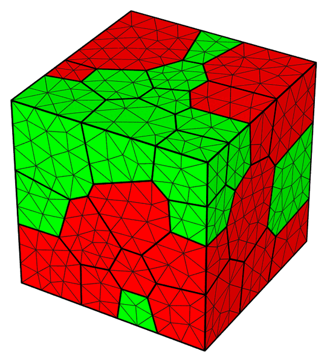
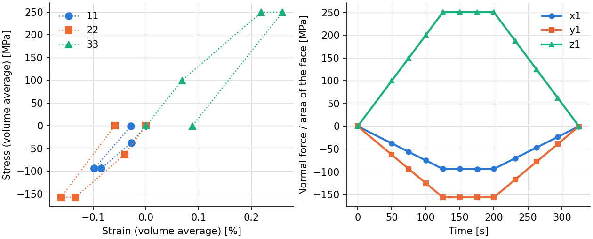
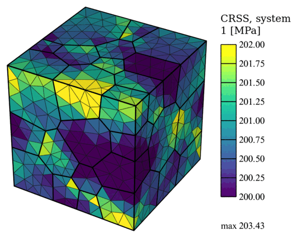

.. _tutorial_multiaxial_clr:

Multiaxial Control at a Constant Load Rate
==========================================

.. note:: Read first: :ref:`tutorial_multiaxial_csr`.

A two-phase polycrystal of 50 grains in the unit cube is used, with its phases in the mesh's
``$Groups`` section:

   The mesh colored by phase: austenite (fcc, grains 1 to 25) in red, ferrite (bcc, grains 26
   to 50) in green.

The material is an LDX-2101 steel:

.. include:: material_ldx.inc

The polycrystal is loaded with triaxial control at a constant load rate of 2 N/s on component
33 (``control_component 33``), the loads 11 and 22 controlled to keep the ratios
-0.375 : -0.625 : 1, to 100 N (step 1) and 250 N (step 2); the loads are then held for 75 s
(step 3, a dwell: ``load_rate 0`` and ``target_duration``) and the sample is unloaded to zero
(step 4). During the dwell every load is held where step 2 left it (``load_rate 0`` on 11 and
22 as well). The load steps are cut into equal increments (``number_of_incrs``). The nodal
coordinates, the slip strengths, the stresses and strains, and the face forces are written.

Input Files
-----------

- :download:`simulation.cfg <../../tutorials/multiaxial_clr/simulation.cfg>`
- :download:`simulation.msh <../../tests/regression/cases/meshes/tutorial_triax_dual.msh>`

.. literalinclude:: ../../tutorials/multiaxial_clr/simulation.cfg

Execution
---------

.. code-block:: console

  $ mpirun -np 4 fepx

.. literalinclude:: generated/multiaxial_clr/terminal.txt
   :language: none

.. literalinclude:: generated/multiaxial_clr/tree.txt
   :language: none

Simulation Results
------------------

   (left) Volume-averaged normal stresses against the normal strains at the ends of the steps;
   (right) normal stresses of faces :file:`x1`, :file:`y1` and :file:`z1` (force over current
   area) at every increment: loading, dwell (the stresses held) and unloading.

   Slip strength of system 1 after unloading (displacements magnified 10 times).

The commands:

.. literalinclude:: generated/multiaxial_clr/commands.txt
   :language: console
