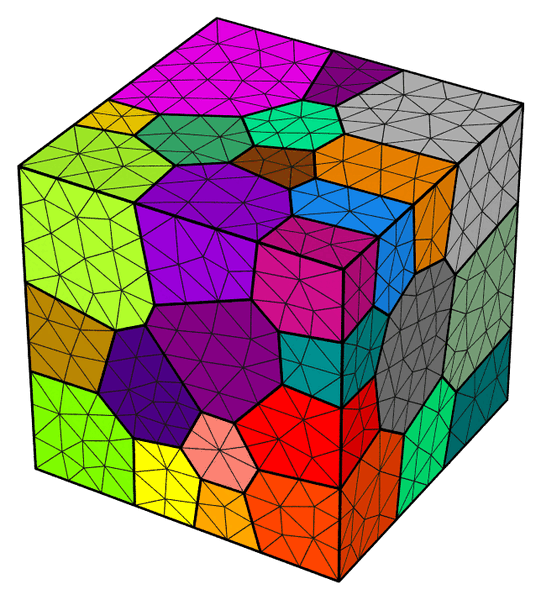
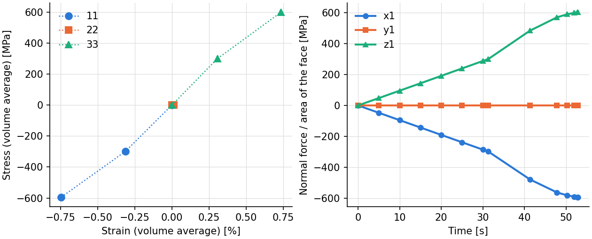
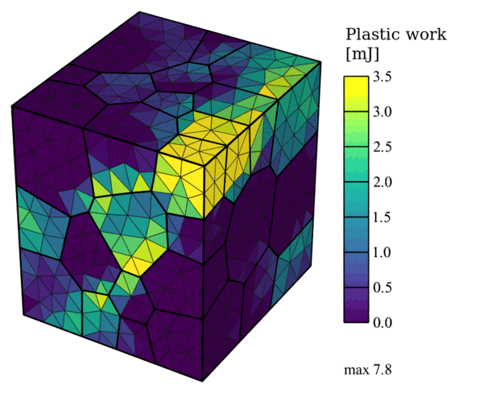
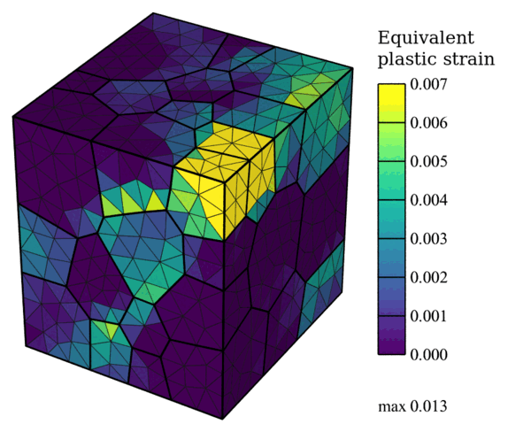

.. _tutorial_multiaxial_csr:

Multiaxial Control at a Constant Strain Rate
============================================

.. note:: Read first: :ref:`tutorial_simple`.

A polycrystal of 50 grains in the unit cube is used:

   The mesh, colored by grain.

The material is the :math:`\alpha` phase (hcp) of Ti-6Al-4V, with anisotropic hardening and a
saturation strength that evolves with the slip rate:

.. include:: material_ti.inc

.. list-table:: Plasticity parameters (``saturation_anisotropic`` hardening, ``saturation_evolution on``).
   :header-rows: 1
   :align: center

   * - :math:`m` [-]
     - :math:`\dot{\gamma}_0` [1/s]
     - :math:`h_0` [MPa]
     - :math:`\tau_{s}` [MPa]
     - :math:`m'` [-]
     - :math:`\dot{\gamma}_{s0}` [1/s]
     - :math:`n` [-]
   * - 0.01
     - 1.0
     - 190.0
     - 700.0
     - 1.1
     - 1.0
     - 1.0

.. list-table:: Initial slip strengths of the three slip families and interaction coefficients.
   :header-rows: 1
   :align: center

   * - :math:`\tau_0` basal [MPa]
     - :math:`\tau_0` prismatic [MPa]
     - :math:`\tau_0` pyramidal :math:`\langle c+a \rangle` [MPa]
     - diagonal [-]
     - co-planar [-]
   * - 390.0
     - 468.0
     - 663.0
     - 1.0
     - 1.4

The interaction matrix is written row by row (``interaction_matrix``): 1 on the diagonal, 1.4
between the basal systems and within each pair of co-planar pyramidal systems, 0 elsewhere.

The polycrystal is loaded biaxially with triaxial control (``boundary_conditions triaxial``, see
:ref:`deformation_history`): component 11 is driven at a constant strain rate
(``control_component 11``), and the loads on 22 and 33 are controlled so that the loads keep the
ratios -1 : 0 : 1 along the load path, to the loads (-300, 0, 300) N in step 1 and (-600, 0, 600)
N in step 2. The strain rate doubles in step 2. The nodal coordinates, the equivalent plastic
strain, the plastic work, the stresses and strains, and the face forces are written.

Input Files
-----------

- :download:`simulation.cfg <../../tutorials/multiaxial_csr/simulation.cfg>`
- :download:`simulation.msh <../../tests/regression/cases/meshes/tutorial_triax.msh>`

.. literalinclude:: ../../tutorials/multiaxial_csr/simulation.cfg

Execution
---------

.. code-block:: console

  $ mpirun -np 4 fepx

.. literalinclude:: generated/multiaxial_csr/terminal.txt
   :language: none

.. literalinclude:: generated/multiaxial_csr/tree.txt
   :language: none

Simulation Results
------------------

   (left) Volume-averaged normal stresses against the normal strains at the ends of the steps;
   (right) normal stresses of faces :file:`x1`, :file:`y1` and :file:`z1` (force over current
   area) at every increment: the stress 11 rises twice as fast in step 2.

   Plastic work at the end of step 2 (displacements magnified 10 times). Unlike in a uniaxial
   simulation, the faces stay plane under triaxial control.

   Equivalent plastic strain at the end of step 2 (displacements magnified 10 times).

The commands:

.. literalinclude:: generated/multiaxial_csr/commands.txt
   :language: console
