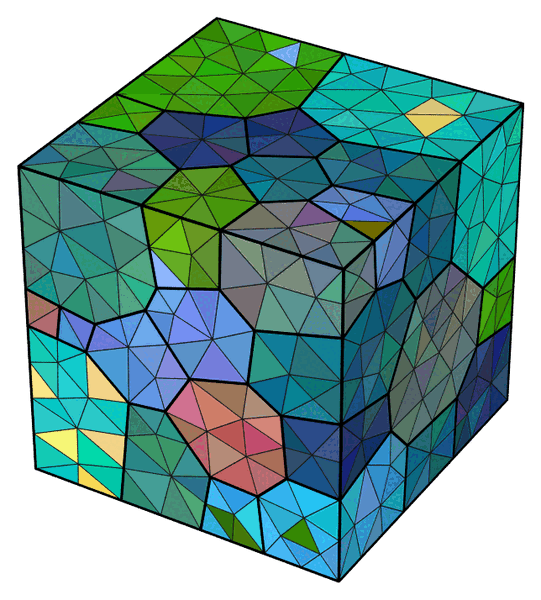
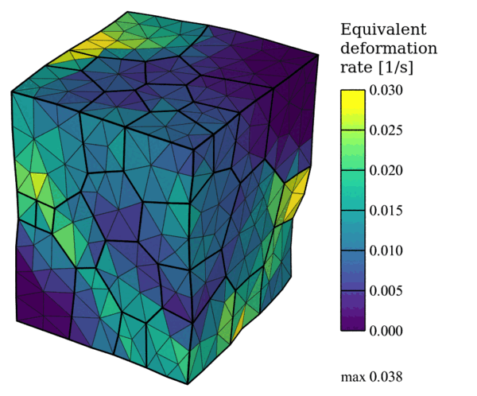
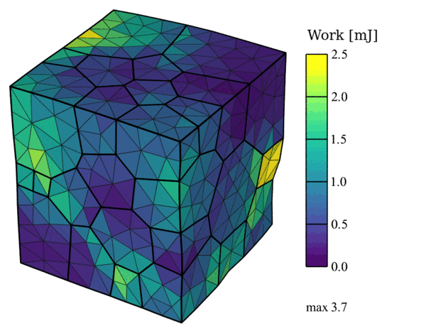
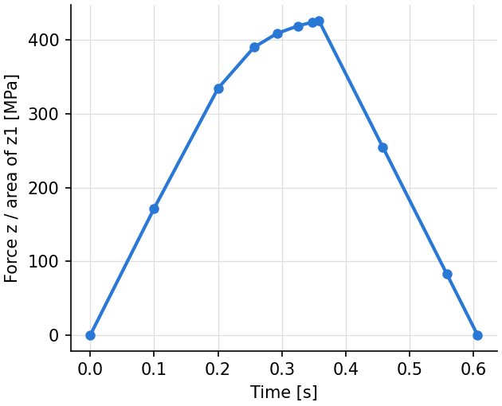

.. _tutorial_overwriting:

Overwriting Polycrystal Attributes
==================================

.. note:: Read first: :ref:`tutorial_simple`.

Some inputs can be read from separate files, so that the same configuration and mesh files
serve several simulations in which the microstructure varies (``read_phase_from_file``,
``read_ori_from_file``, see :ref:`file_formats`). In this tutorial, a polycrystal of 50 grains
gets its phases from :file:`simulation.phase` and per-element orientations from
:file:`simulation.ori`. Neper generated the tessellation with the orientations of a file
:file:`orifile` (one per grain), spread about each grain's orientation by a normal distribution
of 5 degrees, and the mesh, with:

.. code-block:: console

  $ neper -T -n 50 -reg 1 -group "id<=25?1:2" -ori "file(orifile,des=rodrigues)" \
      -orispread "normal(5)" -oridescriptor "rodrigues:active" -morpho gg -o simulation
  $ neper -M simulation.tess -order 2 -format msh,ori -part 4

The phases are given per grain (element set) in :file:`simulation.phase`: grains 1 to 25 are
of phase 1, grains 26 to 50 of phase 2::

  $Groups
  elset
  50
  1 1
  2 1
  ...
  26 2
  ...
  50 2
  $EndGroups

and the orientations per element in :file:`simulation.ori`::

  $ElementOrientations
  5841 rodrigues:active
  1 <r1> <r2> <r3>
  ...
  $EndElementOrientations

The orientations of :file:`simulation.ori` replace those of the mesh file. As Neper writes it,
the file also holds each grain's orientation (``$ElsetOrientations``); the element orientations,
when given, are used instead. The material is an
LDX-2101 steel, austenite (fcc) and ferrite (bcc):

.. include:: material_ldx.inc

The sample is loaded along :math:`z` with the minimal conditions (``uniaxial_minimal``) at a
strain rate of 0.01 /s to the load 425 N, then unloaded at the same rate to 0 N; both steps end
at a load target (``target_load``), with time increments of 0.1 s, shortened down to 0.01 s near
the target. The orientations, the equivalent deformation rate, the work, the nodal coordinates
and the face forces are written.

Input Files
-----------

- :download:`simulation.cfg <../../tutorials/overwriting/simulation.cfg>`
- :download:`simulation.phase <../../tutorials/overwriting/simulation.phase>`
- :download:`simulation.msh <../../tests/regression/cases/meshes/tutorial_overwriting.msh>`
- :download:`simulation.ori <../../tests/regression/cases/meshes/tutorial_overwriting.ori>`

.. literalinclude:: ../../tutorials/overwriting/simulation.cfg
   :emphasize-lines: 35-36

Execution
---------

.. code-block:: console

  $ mpirun -np 4 fepx

.. literalinclude:: generated/overwriting/terminal.txt
   :language: none

.. literalinclude:: generated/overwriting/tree.txt
   :language: none

Simulation Results
------------------

   The sample colored by element orientation: the orientations vary within each grain.

   Equivalent deformation rate at the end of the loading step (displacements magnified 50
   times).

   Work at the end of the unloading step (displacements magnified 50 times).

   Stress of face :file:`z1` (force over current area) at every increment: the increments
   shorten as each step approaches its load target.

The commands:

.. literalinclude:: generated/overwriting/commands.txt
   :language: console
