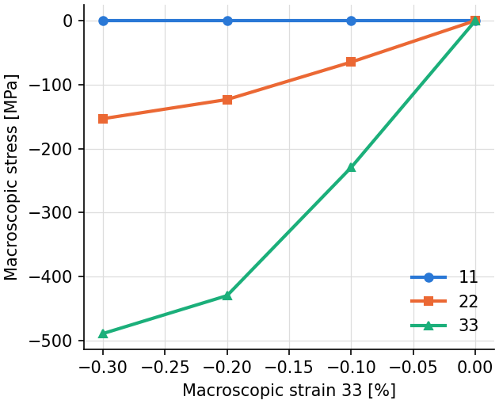
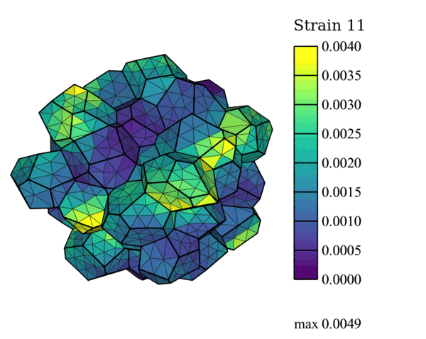

.. _tutorial_periodic:

Periodic RVE-Type Simulation
============================

.. note:: Read first: :ref:`tutorial_simple`.

A periodic polycrystal of 40 grains, generated and meshed by Neper with ``-periodicity all``
(which writes the mesh's ``$Periodicity`` section), is used:

   The mesh, colored by grain. The grains are those of a periodic tessellation of the unit cube:
   a grain cut by a face of the cube continues on the opposite face, and the mesh keeps the
   grains whole, so that its boundary is not the cube's (the mesh fills the unit cube's
   volume, and repeats in the three directions).

The domain is the unit cube. A bcc material is considered:

.. list-table:: Single-crystal elastic constants and plasticity parameters (``saturation_isotropic`` hardening).
   :header-rows: 1
   :align: center

   * - :math:`c_{11}` [MPa]
     - :math:`c_{12}` [MPa]
     - :math:`c_{44}` [MPa]
     - :math:`m` [-]
     - :math:`\dot{\gamma}_0` [1/s]
     - :math:`\tau_0` [MPa]
     - :math:`h_0` [MPa]
     - :math:`\tau_s` [MPa]
     - :math:`n` [-]
   * - :math:`236.9 \times 10^3`
     - :math:`140.6 \times 10^3`
     - :math:`116.0 \times 10^3`
     - 0.02
     - 1.0
     - 200.0
     - 391.9
     - 335.0
     - 1.0

With periodic conditions (``boundary_conditions periodic``, see :ref:`periodic_conditions`),
the loading is given by components of the macroscopic velocity gradient: here plane-strain
compression, with the strain rate 33 at -0.01 /s, the rates 22 and 23 zero, and 11, 12 and 13
free (no row: their macroscopic stresses are zero), to the strain -0.003 in increments of
0.001. Rigid-body motions are fixed automatically.

Input Files
-----------

- :download:`simulation.cfg <../../tutorials/periodic_rve/simulation.cfg>`
- :download:`simulation.msh <../../tests/regression/cases/meshes/tutorial_periodic_part4.msh>`

.. literalinclude:: ../../tutorials/periodic_rve/simulation.cfg
   :emphasize-lines: 21-28

Execution
---------

.. code-block:: console

  $ mpirun -np 4 fepx

.. literalinclude:: generated/periodic_rve/terminal.txt
   :language: none

.. literalinclude:: generated/periodic_rve/tree.txt
   :language: none

With periodic conditions, no face forces are written; the macroscopic deformation gradient and
the volume-averaged stress are written at every increment to :file:`results/macro` (see
:ref:`simulation_results`).

Simulation Results
------------------

   Macroscopic stresses 11, 22 and 33 against the macroscopic strain 33
   (:math:`\bar F_{33} - 1`), at every increment, from :file:`results/macro`.

   Strain field :math:`\epsilon_{11}` at -0.3 % strain 33 (displacements magnified 50 times).

The commands:

.. literalinclude:: generated/periodic_rve/commands.txt
   :language: console
