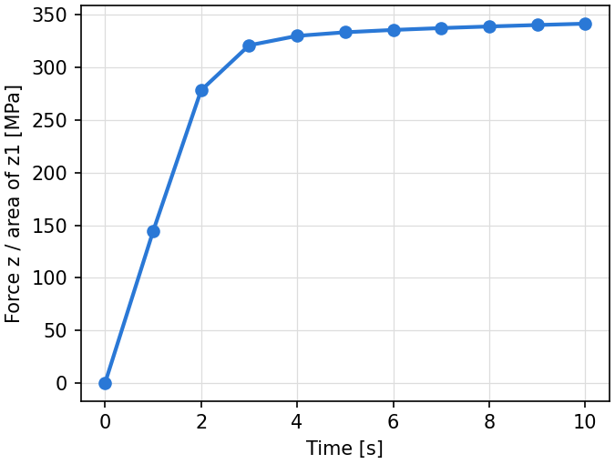
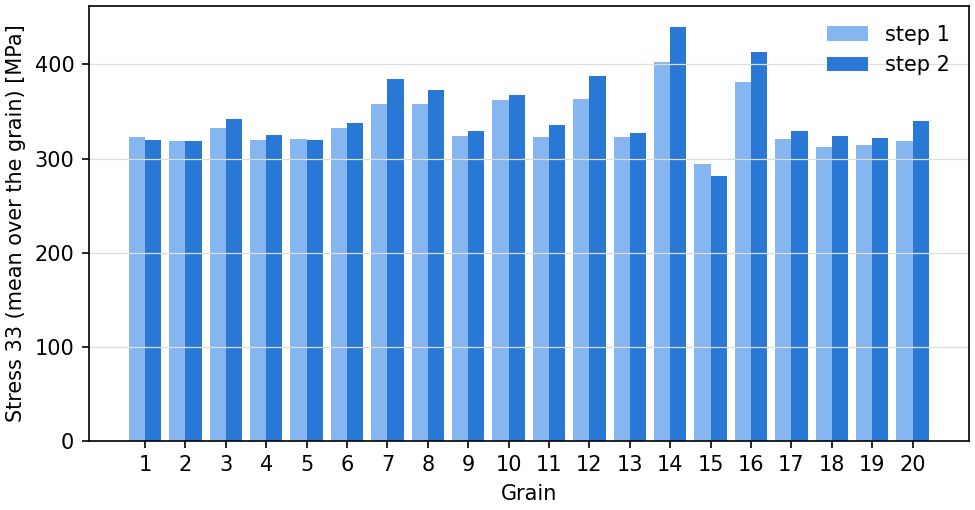

.. _tutorial_postprocessing:

Post-Processing in Python
=========================

.. note:: Read first: :ref:`tutorial_simple`.

The results in :file:`simulation.sim` are text files (see :ref:`simulation_results`), which
NumPy reads directly. This tutorial reads the results of :ref:`tutorial_simple` with a short
Python script, which plots the stress of face :file:`z1` at every increment and the mean stress
of each grain at the end of each step, and prints the mean stresses.

- :download:`postprocess.py <../../tutorials/postprocessing/postprocess.py>`

.. literalinclude:: ../../tutorials/postprocessing/postprocess.py
   :language: python

In the directory of :ref:`tutorial_simple`, after the run:

.. code-block:: console

  $ python3 postprocess.py simulation.sim

.. literalinclude:: generated/postprocessing/postprocess.txt
   :language: none

   :file:`stress_time.png`: the stress of face :file:`z1` (force over current area) at every
   increment.

   :file:`grains.png`: the stress 33 of each grain, the mean over its elements, at the end of
   steps 1 and 2.

Notes:

- The element results are written once per element, in the order of the 3D elements of the mesh
  file, which is how the script matches them with their grains (the first tag of each element
  of the mesh file's ``$Elements`` section).
- The mean over the elements is not volume-weighted. Neper computes the volume averages over the
  mesh (``neper -S simulation.sim -resmesh stress,strain``, written to
  :file:`simulation.sim/results/mesh`) and over each grain (``-reselset``), as the other
  tutorials use for their stress-strain curves.
- With ``output_format hdf5``, the same results are in :file:`simulation.sim/simulation.h5`,
  read with h5py (see :ref:`output_formats`).
