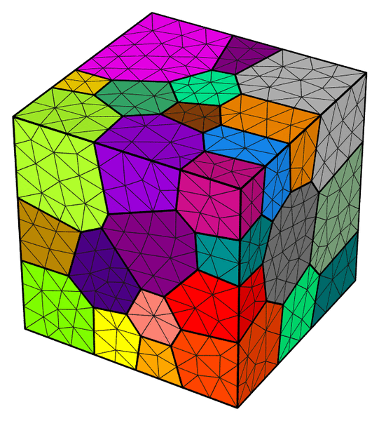
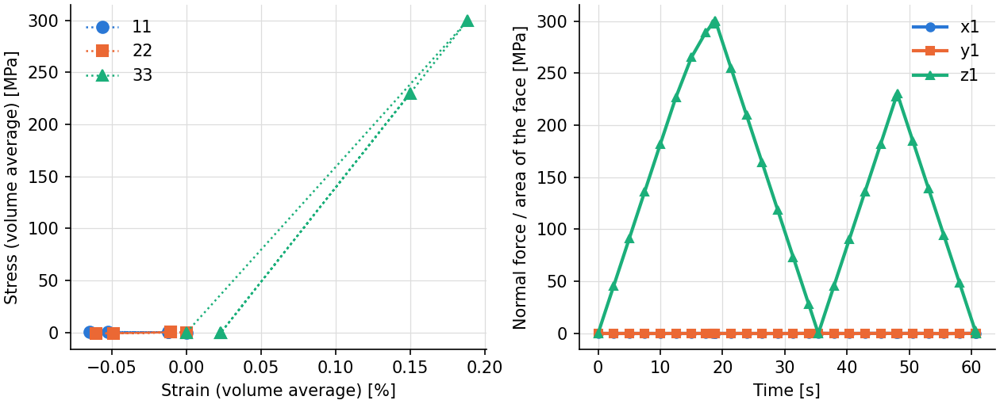
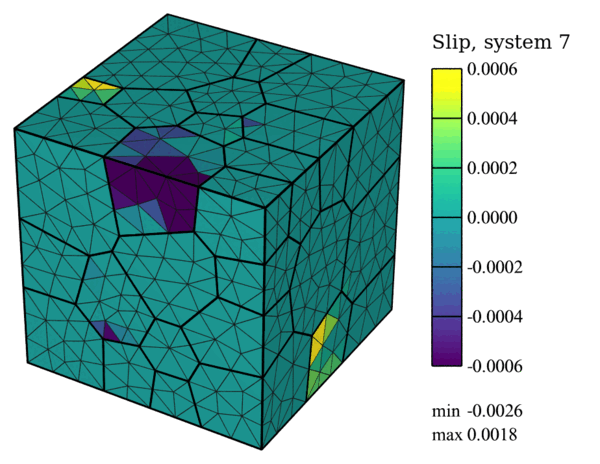
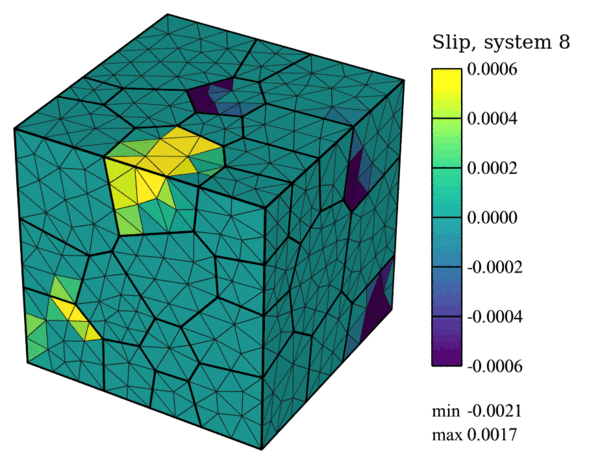

.. _tutorial_restart:

Restarting a Simulation
=======================

.. note:: Read first: :ref:`tutorial_multiaxial_csr`.

A completed simulation can be continued with more loading steps (see :ref:`restart`). In this
tutorial, an fcc polycrystal of 50 grains (the mesh of :ref:`tutorial_multiaxial_csr`) is
loaded in two cycles, run one after the other:

   The mesh, colored by grain.

The material is an AL6XN steel, with cyclic hardening:

.. list-table:: Single-crystal elastic constants and plasticity parameters.
   :header-rows: 1
   :align: center

   * - :math:`c_{11}` [MPa]
     - :math:`c_{12}` [MPa]
     - :math:`c_{44}` [MPa]
     - :math:`m` [-]
     - :math:`\dot{\gamma}_0` [1/s]
     - :math:`\tau_0` [MPa]
     - :math:`h_0` [MPa]
     - :math:`\tau_s` [MPa]
     - :math:`n` [-]
   * - :math:`204.6 \times 10^3`
     - :math:`137.7 \times 10^3`
     - :math:`126.2 \times 10^3`
     - 0.02
     - 1.0
     - 160.0
     - 375.0
     - 1000.0
     - 1.0

.. list-table:: Cyclic hardening parameters (``cyclic_hardening on``).
   :header-rows: 1
   :align: center

   * - :math:`a` [-]
     - :math:`c` [-]
   * - 0.05
     - 3.5

The polycrystal is loaded along 33 at a constant strain rate with triaxial control, the loads 11
and 22 held at zero. The first run loads to 300 N and unloads to 0 N, and writes a restart point
at the end of every step (``print restart``).

First Run
---------

- :download:`simulation.cfg <../../tutorials/restart_cycle1/simulation.cfg>`
- :download:`simulation.msh <../../tests/regression/cases/meshes/tutorial_triax.msh>`

.. literalinclude:: ../../tutorials/restart_cycle1/simulation.cfg
   :emphasize-lines: 42

.. code-block:: console

  $ mpirun -np 4 fepx

.. literalinclude:: generated/restart_cycle1/terminal.txt
   :language: none

.. literalinclude:: generated/restart_cycle1/tree.txt
   :language: none

Second Run
----------

The second run, in the same directory, continues :file:`simulation.sim`: it reloads to 230 N and
unloads again. Its configuration file replaces the first; it has ``restart on`` and lists only
the new steps, which are written as steps 3 and 4. The material, the boundary conditions and the
input files must be those of the first run.

- :download:`simulation.cfg <../../tutorials/restart_cycle2/simulation.cfg>`

.. literalinclude:: ../../tutorials/restart_cycle2/simulation.cfg
   :emphasize-lines: 24

.. code-block:: console

  $ mpirun -np 4 fepx

.. literalinclude:: generated/restart_cycle2/terminal.txt
   :language: none

The simulation directory then holds the results of both runs. Post-process it with Neper
(``neper -S``) after the second run: Neper's results of the first run (in
:file:`simulation.sim/results/mesh`) cannot be extended to the new steps; remove them before
running ``neper -S`` again.

.. literalinclude:: generated/restart_cycle2/tree.txt
   :language: none

Simulation Results
------------------

   (left) Volume-averaged normal stresses against the normal strains at the ends of the four
   steps; (right) normal stresses of faces :file:`x1`, :file:`y1` and :file:`z1` (force over
   current area) at every increment of both runs.

   Accumulated slip on system 7 after the second cycle (displacements magnified 10 times).

   Accumulated slip on system 8 after the second cycle (displacements magnified 10 times).

The commands, after the second run:

.. literalinclude:: generated/restart_cycle2/commands.txt
   :language: console
