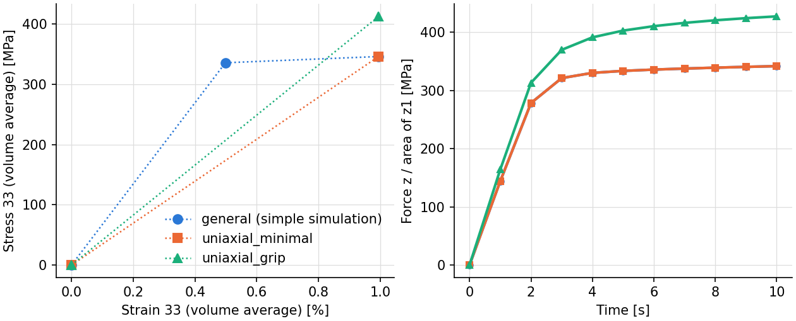
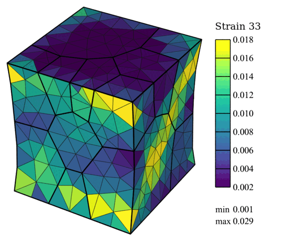
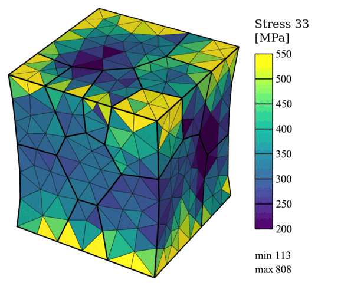

.. _tutorial_simple_rve:

Simple RVE-Type Simulation
==========================

.. note:: Read first: :ref:`tutorial_simple`.

The polycrystal, material and loading of :ref:`tutorial_simple` are used. As the domain is a
cubic "(representative) volume element", and the aim is to apply a uniform loading, it is
natural to give the loading by a *strain rate*, a *target strain* and *strain increments*
instead of velocities, target times and time increments, and to take the boundary conditions
from a preset instead of writing them node set by node set (see :ref:`boundary_conditions` and
:ref:`deformation_history`).

Strain Rate, Target Strain and the ``uniaxial_minimal`` Preset
--------------------------------------------------------------

The conditions of :ref:`tutorial_simple` are the ``uniaxial_minimal`` preset: face :file:`z0`
fixed along :math:`z`, corner :file:`x0y0z0` along :math:`x` and :math:`y`, corner
:file:`x1y0z0` along :math:`y`, and the loading face :file:`z1` moved along :math:`z`. The
simulation is loaded at the strain rate 0.001 /s to the strain 0.01, in increments of 0.001,
in one step:

- :download:`simulation.cfg <../../tutorials/simple_rve/simulation.cfg>`
- :download:`simulation.msh <../../tests/regression/cases/meshes/tutorial_simple_part4.msh>`

.. literalinclude:: ../../tutorials/simple_rve/simulation.cfg
   :emphasize-lines: 21-25

The run (``mpirun -np 4 fepx``) writes:

.. literalinclude:: generated/simple_rve/terminal.txt
   :language: none

and the simulation directory:

.. literalinclude:: generated/simple_rve/tree.txt
   :language: none

The results are those of :ref:`tutorial_simple` (whose fields are shown there) at 1 % strain:

   (left) Volume-averaged stress against strain at the ends of the steps, and (right) stress of
   face :file:`z1` at every increment, of the simple simulation (two steps of 5 increments), of
   this input (one step of 10 increments), and of the grip variant below.

Grip Conditions (``uniaxial_grip``)
-----------------------------------

The ``uniaxial_grip`` preset also fixes faces :file:`z0` and :file:`z1` along :math:`x` and
:math:`y`, as grips would: the loading faces cannot contract, which gives different strain and
stress fields, especially near them, and a stiffer response (above). Only the preset changes:

- :download:`simulation.cfg <../../tutorials/simple_rve_grip/simulation.cfg>`

.. literalinclude:: ../../tutorials/simple_rve_grip/simulation.cfg
   :emphasize-lines: 21

   Strain field :math:`\epsilon_{33}` at 1 % strain, grip conditions (displacements magnified
   10 times; the color scale of :ref:`tutorial_simple`).

   Stress field :math:`\sigma_{33}` at 1 % strain, grip conditions (displacements magnified
   10 times; the color scale of :ref:`tutorial_simple`).

The commands, in the grip simulation's directory:

.. literalinclude:: generated/simple_rve_grip/commands.txt
   :language: console

and for the curves (in this tutorial's directory, beside the other two):

.. literalinclude:: generated/simple_rve/commands.txt
   :language: console
