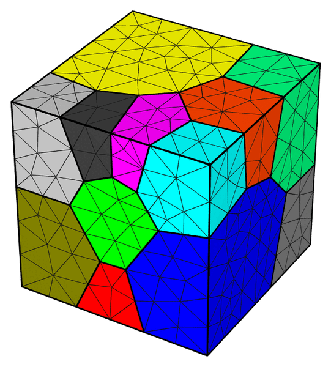
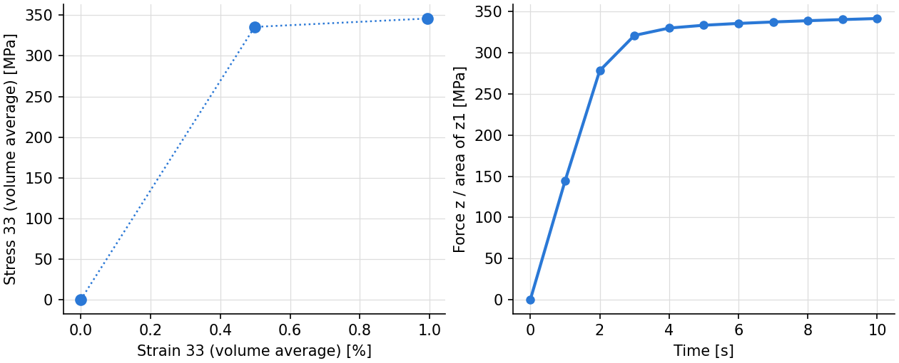
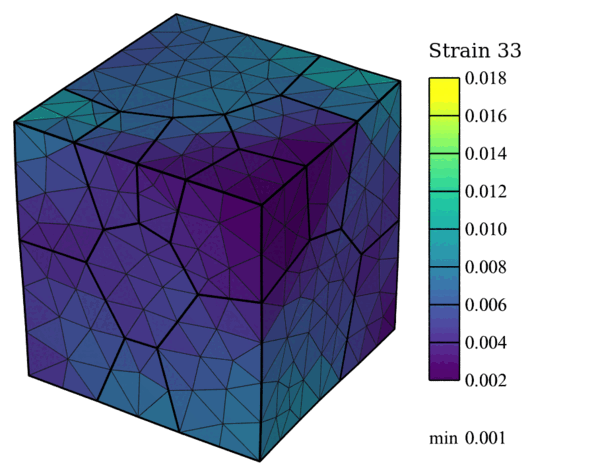
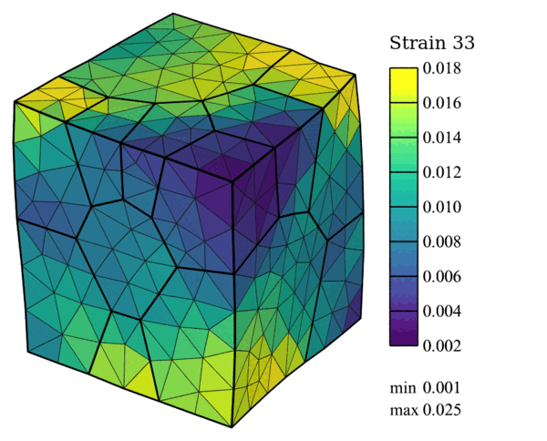
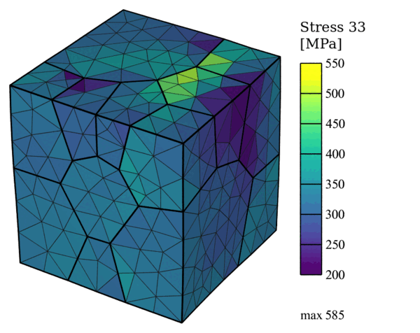
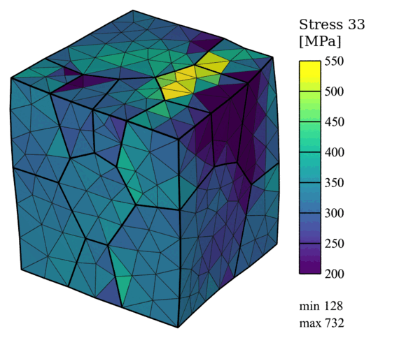

.. _tutorial_simple:

Simple Simulation
=================

.. note:: Read also: :ref:`tutorial_simple_rve`.

A polycrystal of 20 grains, generated and meshed by Neper, is used:

   The mesh (10-node tetrahedra), colored by grain.

The domain is the unit cube. Length units are mm, so that stresses (and the material parameters)
are in MPa. An fcc material with anisotropic elasticity and the crystal-plasticity model with
isotropic saturation hardening (:ref:`material_behavior`) is considered, with the parameters:

.. include:: material_simple.inc

The polycrystal is pulled along :math:`z` at a rate of 0.001 /s, by velocity conditions given
node set by node set (``boundary_conditions general``, see :ref:`boundary_conditions`):
:math:`v_z = 0` on face :file:`z0`, :math:`v_z = 0.001` mm/s on face :file:`z1`, and two corners
fixed against rigid-body motion. The loading has two steps, which end at the times 5 s and 10 s
(0.5 % and 1 % strain), with increments of 1 s. The nodal coordinates and the elemental
orientations, stresses and strains are written at the end of each step, and the face forces at
every increment.

Input Files
-----------

- :download:`simulation.cfg <../../tutorials/simple_simulation/simulation.cfg>`
- :download:`simulation.msh <../../tests/regression/cases/meshes/tutorial_simple_part4.msh>`

.. literalinclude:: ../../tutorials/simple_simulation/simulation.cfg

Execution
---------

In the directory holding the two files:

.. code-block:: console

  $ mpirun -np 4 fepx

.. literalinclude:: generated/simple_simulation/terminal.txt
   :language: none

The mesh was partitioned by Neper into 4 parts, one per process (see :ref:`running`). The content of the resulting simulation
directory (:ref:`simulation_directory`) is:

.. literalinclude:: generated/simple_simulation/tree.txt
   :language: none

Simulation Results
------------------

The stress-strain curve is computed from the volume averages of the stress and the strain at the
end of each step, written by Neper's post-processing (``neper -S``) to
:file:`simulation.sim/results/mesh`; the stress of face :file:`z1` at every increment is its force
over its current area, from :file:`simulation.sim/results/forces/z1`. The curves are plotted with
Python (the script :file:`tutorials/tools/tutorial_pages.py` of the source distribution; see also
:ref:`tutorial_postprocessing`):

   (left) Volume-averaged stress against strain at the end of each step; (right) stress of face
   :file:`z1` (force over current area) at every increment.

The fields at the end of each step are plotted with Neper, on the deformed mesh (displacements
magnified 10 times), with the color scale beside each image (ImageMagick):

   Strain field :math:`\epsilon_{33}` at 0.5 % strain (end of step 1).

   Strain field :math:`\epsilon_{33}` at 1 % strain (end of step 2).

   Stress field :math:`\sigma_{33}` at 0.5 % strain (end of step 1).

   Stress field :math:`\sigma_{33}` at 1 % strain (end of step 2).

The commands, in the simulation's directory:

.. literalinclude:: generated/simple_simulation/commands.txt
   :language: console

Printing Intermediate Results
-----------------------------

The face forces are written at every *increment*, but the nodal and elemental results only at
the end of each *step* (and at the initial state, step 0). Intermediate results are therefore
obtained by cutting the loading into several steps: here two, ending at 5 s and 10 s, so that
the fields above are available at 0.5 % and 1 % strain. With a single step (``number_of_steps
1``, ``target_time 10.0``), only the final fields would be written. The results of a step can
also be left out with ``print_results 0`` for that step (see :ref:`simulation_results`).
